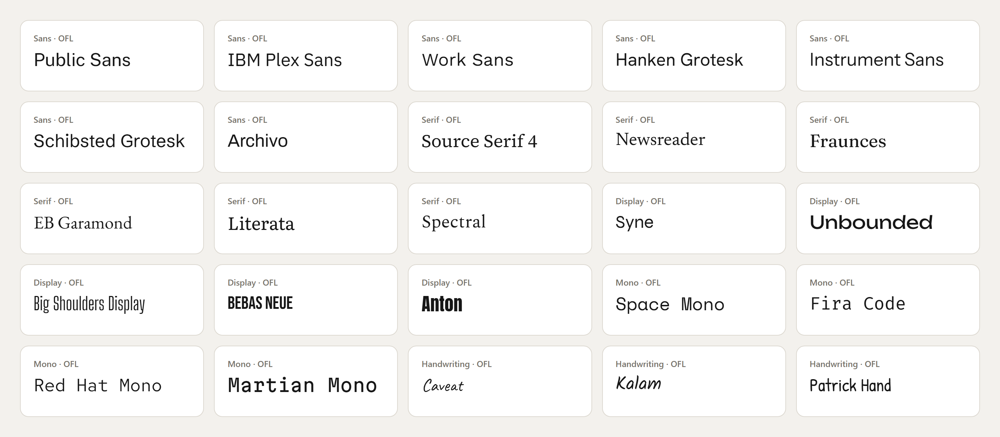
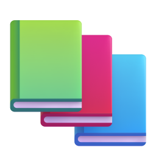
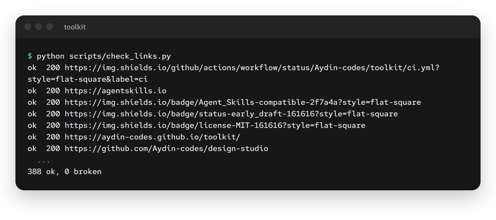

<p align="center">
  
</p>

<h1 align="center">toolkit</h1>

<p align="center">A list of real, free things an AI can build with, so it stops making everything up.</p>

<p align="center">
  <a href="https://github.com/Aydin-codes/toolkit/actions/workflows/ci.yml"></a>
  <a href="https://agentskills.io"></a>
  <a href="CHANGELOG.md"></a>
  <a href="LICENSE"></a>
</p>

<p align="center">
  <a href="#install"><b>Install</b></a> ·
  <a href="#whats-inside">What's inside</a> ·
  <a href="#how-it-works">How it works</a> ·
  <a href="#add-a-tool">Add a tool</a> ·
  <a href="https://github.com/Aydin-codes/design-studio">design-studio</a>
</p>

<p align="center">If the toolkit helps you, please give it a star ⭐</p>

<p align="center">
  <picture>
    <source media="(prefers-color-scheme: dark)" srcset=".github/assets/font-picks-dark.png">
    
  </picture>
</p>
<p align="center"><sub>The 25 starting fonts on the toolkit's fonts page, each shown in itself. All free to use (OFL). Drawn straight from <code>catalog/frontend/type.yaml</code>.</sub></p>

## What it is

When an AI builds a website or app, it makes most things up. It picks the same font every time (usually Inter), draws its own icons, fills gaps with fake photos and "Lorem ipsum", and guesses at libraries it half remembers.

The toolkit is a skill you add to your AI that gives it a list of real things people have already made: fonts, icon sets, photo libraries, UI components, 3D models and so on. Every entry has a link, the licence (so you know if you're allowed to use it), and how the AI installs it. When you ask for something, the AI looks it up here, picks one to three options that fit your project, and tells you why.

It works with any tool that reads `SKILL.md`: Claude Code, Codex, Cursor, Gemini CLI and others. It also comes bundled with [design-studio](https://github.com/Aydin-codes/design-studio): design-studio works out the look with you, and the toolkit knows where to get the parts.

## An example

You ask: *"Pick fonts for my bakery's website."* The AI opens the fonts page and reads entries like these (real lines from [`reference/frontend/type.md`](reference/frontend/type.md)):

> - [Google Fonts](https://fonts.google.com) (search: Google Fonts). Licence: mostly OFL (check each family). Get it: CDN link, or self-host through Fontsource.
> - [Fontsource](https://fontsource.org) (search: Fontsource npm fonts): use when you want to self-host Google and other open fonts as npm packages. Licence: per font, mostly OFL. Install: `npm i @fontsource/<font>`.
> - [Fontshare](https://www.fontshare.com) (search: Fontshare Indian Type Foundry free fonts): use when you want high-quality free fonts that aren't on Google Fonts. Licence: free, not open source (ITF licence); load from Fontshare's CDN, don't redistribute.

The same page lists the fonts AI tools overuse (Inter, Geist, Space Grotesk, DM Sans, Poppins and others), so it knows not to reach for them by default. It answers with one to three picks, each with a link, a reason and the licence, instead of quietly using Inter again.

## How it works

|  |  |  |  |
|:-:|:-:|:-:|:-:|
| **1. Read the index**<br>`SKILL.md` says which page covers what, plus the stack, rules and checks | **2. Open one page**<br>Only the page the task needs, like fonts. Nothing else gets loaded | **3. Pick one to three**<br>Ranked: fits your stack, free, licence allows it, still maintained, easy to install | **4. Check the work**<br>Before saying "done", it runs the quality checklist |

## What's inside

| Page | What it covers | Status |
|---|---|---|
| `SKILL.md` | Which stack to use for 12 kinds of project, 12 rules (tap targets, contrast, focus rings…), a quality checklist and licence rules | Written |
| [Fonts](reference/frontend/type.md) | Where to get free fonts, 25 starting picks by style, type-scale tools, and the fonts AI overuses | Written: 40 entries, every link checked on 26 Nov 2026 |
| UI kits and icons, frameworks, UX, motion, 3D, charts | Component libraries, icon sets, animation and 3D tools | Planned |
| Photos, illustrations, 3D models, sound | Free asset sources with their licences | Planned |
| Back end, platforms, PDF and print, shipping, quality | Databases, auth, hosting, testing and more | Planned |

<details>
<summary><b>A look inside <code>SKILL.md</code>: the stack it suggests for each kind of project</b></summary>

| Building | Front end | Back end / data | Host |
| --- | --- | --- | --- |
| Landing page / portfolio | Astro (or Next.js) + Tailwind | none, or Tally/Formspree form | Vercel / Netlify / Cloudflare Pages |
| SaaS / web app with accounts | Next.js + TypeScript + Tailwind + shadcn/ui | Supabase + Stripe | Vercel |
| Online store | Shopify (or Next.js + Shopify Storefront API) | Shopify | Shopify / Vercel |
| Mobile app | Expo + React Native + TypeScript | Supabase or Firebase | EAS Build → App Store / Google Play |
| Browser game | Phaser (2D) or Three.js/R3F + Rapier (3D) | Colyseus / Socket.IO / Convex | Cloudflare Pages / itch.io |
| Printed document / PDF | Typst, or HTML + Paged.js | data files (CSV, JSON) | PDF file |

The full table in [`SKILL.md`](SKILL.md) has 12 rows, plus a column for look and motion.

</details>

## Install

**Any agent that supports skills:**
```
npx skills add Aydin-codes/toolkit
```

<details>
<summary><b>By hand</b></summary>

| Tool | Where |
| --- | --- |
| Claude Code | `git clone https://github.com/Aydin-codes/toolkit ~/.claude/skills/toolkit` |
| Codex | `git clone https://github.com/Aydin-codes/toolkit ~/.agents/skills/toolkit` |
| Claude app | Download the repo as a zip, then Customize → Skills → Upload a skill |

If you use [design-studio](https://github.com/Aydin-codes/design-studio), you already have it: the plugin ships with a copy.

</details>

## Use

Mention it, or just ask for something it covers:

```text
Use the toolkit to pick fonts for a bakery landing page.
Use the toolkit to choose a stack for a small booking site, then run the quality gate.
Use the toolkit to find free fonts and a type scale for a printed report.
```

The AI says which stack it picked and why, lists the parts it needs and where each one comes from, then builds and runs the checklist.

## How entries are kept honest

Every entry needs a link, a search term (in case the link breaks), a licence and a status. New entries start as **candidate** and become **verified** only after five checks: the licence is read, it had commits in the last 12 months, an AI can install it, it works with its stack, and there's a free demo you can see.

<p align="center"></p>
<p align="center"><sub>The link check, run on 26 Nov 2026. A GitHub workflow runs it again every Monday and opens an issue if anything breaks.</sub></p>

<details>
<summary><b>How the pages are built</b></summary>

The pages in `reference/` are generated. Each entry lives in a YAML file in `catalog/` and becomes one line on its page:

```yaml
- name: Fontsource
  url: https://fontsource.org
  search: Fontsource npm fonts
  licence: per font, mostly OFL
  use_when: you want to self-host Google and other open fonts as npm packages
  install: npm i @fontsource/<font>
  status: candidate
  checked: 2026-11-26
```

```
toolkit/
├── SKILL.md                  the index: stacks, rules, which page to open, quality checklist
├── reference/                generated pages, one per topic (don't edit by hand)
├── catalog/                  the source: one YAML file per page (see SCHEMA.md)
├── scripts/build.py          catalog → reference pages; --check for CI
├── scripts/check_links.py    checks every link, standard library only
└── .github/                  CI, weekly link check, issue forms
```

</details>

## Built with

| | | What it does here |
|:-:|---|---|
|  | YAML | Every entry lives in a small YAML file in `catalog/` |
|  | [Python](https://www.python.org) | Builds the pages from the catalog and checks every link |
|  | [GitHub Actions](https://github.com/features/actions) | Checks the skill and the catalog on every push, and the links every Monday |
|  | [Agent Skills](https://agentskills.io) | The open `SKILL.md` format, so any AI tool that supports skills can load it |

## Current limits

- Only the fonts page is written so far. The other pages that `SKILL.md` points to are planned, and until they exist the AI falls back on the stack table and rules in `SKILL.md`.
- All 40 entries are still **candidate**: their links work, but none has passed the five checks for **verified** yet.
- Licences change. Check anything you'll sell or ship against the source before relying on it.

## Add a tool

Know a free font, icon set, library or asset source that belongs here? Open a [Suggest a tool](https://github.com/Aydin-codes/toolkit/issues/new/choose) issue with the link and one line on when you'd pick it. To edit the catalog yourself, see [CONTRIBUTING.md](CONTRIBUTING.md).

## License

The text in this repo is MIT. Every tool, font and asset it links to keeps its own licence.

<sub>Icons from Microsoft <a href="https://github.com/microsoft/fluentui-emoji">Fluent Emoji</a> (MIT) and <a href="https://simpleicons.org">Simple Icons</a> (CC0). Fonts in the image above are from Google Fonts, all under the SIL Open Font License.</sub>
