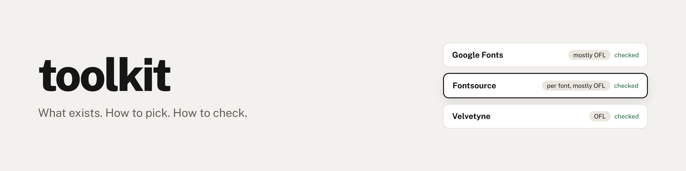

<p align="center">
  
</p>

<h1 align="center">toolkit</h1>

<p align="center">
  <b>What exists, how to pick, how to check.</b><br>
  Frameworks, UI kits, fonts, photos, 3D models, back ends, PDF tools and example repos, with links and licences, for AI coding agents.
</p>

<p align="center">
  <a href="https://github.com/Aydin-codes/toolkit/actions/workflows/ci.yml"></a>
  <a href="https://agentskills.io"></a>
  <a href="LICENSE"></a>
  <a href="CHANGELOG.md"></a>
</p>

<p align="center">
  <a href="#install">Install</a> ·
  <a href="#use">Use</a> ·
  <a href="#how-the-agent-uses-it">How it works</a> ·
  <a href="#adding-a-tool">Add a tool</a> ·
  <a href="CHANGELOG.md">Changelog</a>
</p>

A free and open-source-first reference library for AI coding agents. It tells the agent what already exists (frameworks, UI kits, fonts, photos, 3D models, back ends, PDF tools, example repos), helps it pick 1-3 options for your project, and checks the work with numbered rules.

**Status:** early draft (0.1.0). Links last checked 2026-11-26. The core `SKILL.md` and the typography branch ([`reference/frontend/type.md`](reference/frontend/type.md)) are written; the other branch files it lists are still to come.

Works with any tool that reads `SKILL.md` (the open [Agent Skills](https://agentskills.io) format): Claude Code, Codex, Cursor, Gemini CLI and others.

## Why

AI-built sites look alike because agents invent everything from scratch with the same few defaults. Real projects are put together from things people already made: fonts, photos, 3D models, components, tested code. This toolkit gives the agent a map of those things, with links and licences, so it builds from real material.

## How it differs

| | Awesome lists | Rule sets (e.g. Vercel guidelines) | Design skills (e.g. design-studio) | **toolkit** |
| --- | --- | --- | --- | --- |
| Lists tools with links | yes | no | some | yes |
| Licence for each entry | rarely | no | some | yes |
| Picks for your project | no | no | yes (taste) | yes (stack and sources) |
| How an agent installs it | no | no | no | yes |
| Checkable rules | no | yes | some | yes, top rules + links to full sets |
| Loads only what the task needs | no | no | varies | yes |

## How the agent uses it

1. Reads `SKILL.md` (about 140 lines): rules, decision model, stack table, index.
2. Opens one branch file for the task, e.g. `reference/frontend/type.md` for fonts.
3. Picks 1-3 options using a fixed order: fits the stack, free, licence, maintained, agent can install it, popularity.
4. Builds, then runs the quality gate.

## Structure

```
toolkit/
├── SKILL.md                  core: rules, decision model, stacks, index, quality gate
├── reference/                generated pages, one per branch (don't edit by hand)
│   ├── frontend/             type (written); frameworks, ui, ux, motion, 3d, dataviz to come
│   ├── assets/               ready-made, make-your-own, ai-generators (to come)
│   └── plan, backend, platforms, print-pdf, ship, quality, rules, agent-tooling, learn (to come)
├── catalog/                  the source: one YAML file per branch (see SCHEMA.md)
├── scripts/build.py          catalog → reference pages; --check for CI
├── scripts/check_links.py    checks every link, standard library only
└── .github/                  CI, weekly link check, issue forms
```

## Install

**Any agent that supports skills:**
```
npx skills add Aydin-codes/toolkit
```

**By hand:**

| Tool | Where |
| --- | --- |
| Claude Code | `git clone https://github.com/Aydin-codes/toolkit ~/.claude/skills/toolkit` |
| Codex | `git clone https://github.com/Aydin-codes/toolkit ~/.agents/skills/toolkit` |
| Claude app | Download the repo as a zip, then Customize → Skills → Upload a skill |

It also ships inside the [design-studio](https://github.com/Aydin-codes/design-studio) plugin, so installing that gets both.

## Use

```text
Use the toolkit to pick fonts for a bakery landing page.
Use the toolkit to choose a stack for a small booking site, then run the quality gate.
Use the toolkit to find free fonts and a type scale for a printed report.
```

The agent says which stack row it picked and why, lists the assets it needs and where each comes from, then builds and runs the quality gate.

## Adding a tool

Open an issue with the link. It goes in as a **candidate** and becomes **verified** when it passes five checks: licence read, commits in the last 12 months, an agent can install it, it works with its stack, and there's a free demo.

## Licence

The text in this repo is MIT. Every tool, font and asset it links to keeps its own licence.
